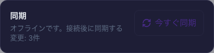

# Webの未送信操作を保持した再起動確認（2026-10-25 / #833）

計画④ [#699](https://github.com/YuTakane256/Life-Quest/issues/699) / T05。
main `7dc1283c422459ab42bfaa1ccb7c4a4f84feaba7`（#832マージ後）を基準に、
承認済みの専用Supabaseと既存テストアカウントAで確認した。

**Webの1件では、未送信のままブラウザプロセスを強制終了し、オフラインで再起動してから接続を戻せた。**
Nativeのプロセス終了/回線切断、期限切れセッション、T06〜T08の合格にはしない。

## 確認用プレビュー

`npm run sync:staging:web`はVite開発サーバーで、PWAのService Workerを使うオフライン起動の確認には適さない。
`npm run sync:staging:web:preview`を追加し、通常のアプリをproductionビルドして固定のlocalhost:4176で配信する。

- `.staging-sync.local`の同じ検証・許可項目と環境分離を使い、通常の.envは読まない。
- ポート使用中ならビルド前に停止する。配信にもstrictPortを指定し、既存サーバーを止めず別ポートへ移動しない。
- 出力先は毎回新規作成する一時ディレクトリだけ。通常distは使わず、終了後に自分の一時出力だけを削除する。
- ビルド失敗やSIGINT/SIGTERMで中断した場合はプレビューを起動しない。
- ブラウザのキャッシュ/保存データは終了後も保持する。初回のオンライン起動、Service Workerによる制御と更新後のコード確認は必要。

既存のPWA/アプリコード、DB/RLS/API、保存形式、同期・報酬ロジックの変更はない。
このプレビューはローカル検証用で、⑤の署名済みMobileビルドではない。

## 実操作と照合

専用Chromium profile（新規origin・402×874・headless）の通常ログイン/フォームを使った。
アカウント/接続先を照合し、オンラインでPWAのインストールとページ制御を確認してから切断した。
同じAでログインした別のNode SDKをオンラインの読み取り専用確認側とし、操作側のoutboxをコピーしていない。

| 段階 | 確認したこと |
| --- | --- |
| オフライン操作 | 操作用ブラウザだけを切断。親タスク1件・子1件を追加し、親の重要度をhighからmediumへ編集。期限2026-10-29、タグrestart、未完了を維持 |
| 終了前 | localStorageに同じAの未送信操作3件と親子データが存在。オンラインの確認側ではDBに親が存在しない。操作キー3個が重複していない |
| プロセス終了 | Playwrightが起動した専用Chromiumのcommand lineから専用profileを確認し、CDPのbrowser PIDだけにSIGKILL。接続終了を待機。通常ChromeやMac全体のネットワークは変更していない |
| オフライン再起動 | 同じprofileを、起動時からoffline=trueで新しいChromiumプロセスへ渡す。異なるPIDと同じ専用profileを確認。キャッシュからタスク画面を開き、同じ所有者・親子データ・3個の操作キーが残ることを照合 |
| 再起動後の表示 | 復元処理後に「オフライン・3件」を表示し、今すぐ同期は無効。ライト/ダーク双方を確認。DBにはまだ親が存在しない |
| 接続復帰 | ブラウザの接続を戻し、アプリの通常の復帰処理で送信。DBの親1件・有効な子1件、Aの所有、期限/重要度/タグを照合。端末の未送信0件・失敗/競合0件、同期済み表示を確認 |

待機中の再起動を再度行っても新しいタスク/操作キーを作っていない。
試験用ブラウザの所有確認と状態復元の待機を調整した後に、同じデータを保持したまま最終の強制終了→再起動→復帰を確認した。
画面が見えただけで復元完了とは判定せず、ユーザー別の永続outboxとローカルの対象タスクを照合した。

今回のCache Storageの37エントリーは同じoriginのアプリシェルだけで、Supabase/Auth/RESTの応答は含まなかった。
APIレスポンスをService Workerへキャッシュする実装は追加していない。
資格情報・セッション・生のoutbox payload/操作キーは資料やログへ公開しない。

## 確認画像

同期カードのみ。メールアドレスやアカウント画面は含めていない。
再起動後のライト/ダークは同じ3件待機の状態で、テーマ設定systemを維持しブラウザの配色条件だけを切り替えた。

| 再起動後・ライト | 再起動後・ダーク | 接続復帰後・ライト |
| --- | --- | --- |
|  |  |  |

## 回帰と残る項目

- 専用起動の単体23件成功。継承設定の除去、設定不正/占有ポート、ビルド失敗/例外/中断、一時出力の保持と削除を確認。
- 単体全体3,356件成功/98件skip。Web/core/Mobile型検査、check:secrets、lint成功（既存警告6件）、専用PWAビルド成功。
- 実際の専用プレビューもSIGINTで終了コード130になり、配信ポートの停止と自分の一時出力の削除を確認。
- **T05はWeb・A・タスク1件/子1件・有効な保存済みセッションの範囲でpass。T05全体は部分確認。**
- Native T04の実回線切断/接続通知、Native T05、T06のUIアカウント切替、T07の報酬再送、T08の期限切れ復帰は未確認。
- Android/実機、⑤の配布・実機認証、旧ID失敗データの救済 #827 も残る。

タスクの完了や報酬操作を行っていないため、報酬の冪等性試験の代用にはしない。
ブラウザプロセスの終了であり、Mac自体の電源断・ディスク故障・書込途中の全障害耐性の保証でもない。
アカウント追加/削除、DB初期化、古い失敗キューの破棄/再送はしていない。
検証用データとprofileは次回のために保持する。通常のブラウザと専用Simulatorは操作していない。
