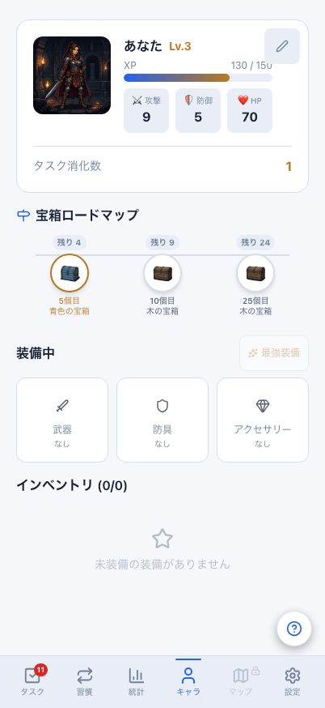
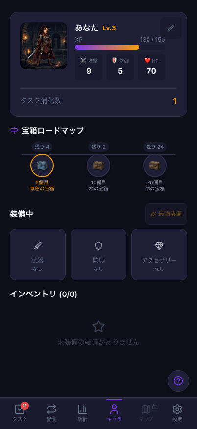
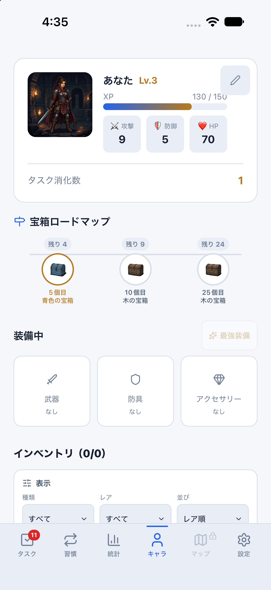
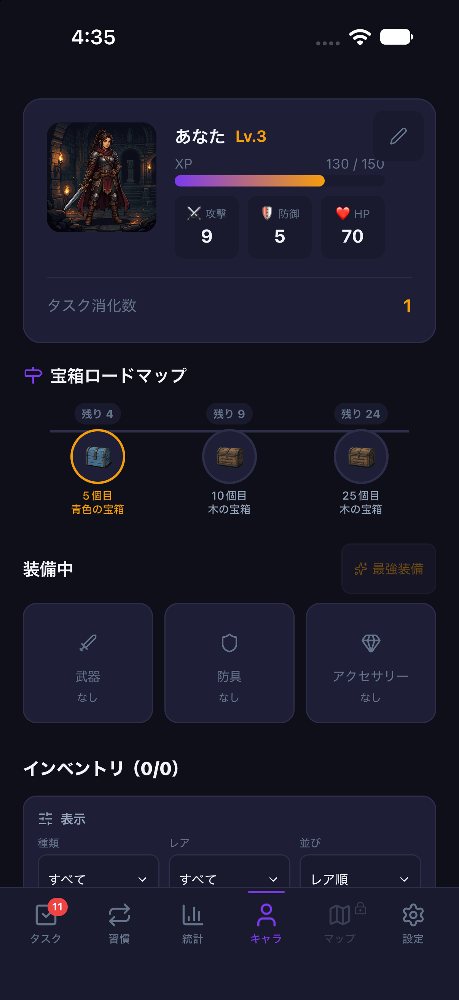

# タスク完了の応答喪失・再試行と報酬の重複確認（2026-10-27 / #844）

計画④ [#699](https://github.com/YuTakane256/Life-Quest/issues/699) / T07のうち、タスク完了を確認した。
通常UIで作成した1件について、サーバー成功後の応答喪失、同じ操作キーの再送、
未完了へ戻して別キーで再完了、送信済み状態のNative再起動、Webとの同期を確認した。
アプリ本体の修正ではなく、実操作の確認記録と進捗の更新である。

## 条件と方法

- 対象main: `498fc6ea908f0ae59fe3e3f3e94ae2eb4d25ed0e`（PR #843マージ後）。
  Native依存に変更がないため、確認済みのparityバイナリを再利用した。
- 専用staging、承認済みの既存A、専用iPhone 18 Pro / iOS 27.0 / 402×874pt。
  `sync:staging:mobile`（8083）と`sync:staging:web`（4175）を使用し、接続先固定・fixture/capture無効。
- Nativeの通常UIから、重要度medium・繰り返しなしの新しいタスクを1件だけ作成した。
  対象名は`Staging Native reward retry 20261027`。過去の検証データは保持している。
- 開発プロセスの通信に一時的な障害を入れ、**指定staging・指定タスクの`complete_task`だけ**を対象にした。
  最初のHTTP 200を受け取って読み捨ててから通信エラーを返し、以後の対象再送を一時保留した。
  Auth・pull・他の操作は通常接続を維持した。OSの回線切断/NetInfo通知の試験ではない。
- Edge呼出しはfetchを捕捉してキャッシュするため、障害を入れる前と除去後に既存のinvokerリセットを使った。
  認証・ゲーム状態・保存データを内部から書き換えず、完了・未完了化・同期は通常UIから操作した。
- SDKのユーザー/接続先を確認し、独立したNode SDKの本人RLS読み取りでDBと照合した。
  内部の冪等性テーブルへアクセスせず、送信キーは対象通信と永続outboxで比較した。
  service_role、DB初期化、残高/装備の直接投入は使用しない。

## 実測結果

| 段階 | XP合計 | タスク消化数 | 当日のタスクXP | 対象の報酬台帳 |
| --- | ---: | ---: | ---: | ---: |
| 完了前 | 110 | 0 | 0 | 0件 |
| 最初のサーバー成功・応答喪失後 | 130 | 1 | 20 | 1件（20 XP） |
| 同じキーで再送・同期後 | 130 | 1 | 20 | 同じ1件 |
| 未完了化→別キーで再完了後 | 130 | 1 | 20 | 同じ1件 |
| Native再起動・再同期、Web同期後 | 130 | 1 | 20 | 同じ1件 |

応答喪失後、Nativeの永続outboxに対象`complete_task`がpending 1件で残った。
設定の「今すぐ同期」で元の操作キーを再送し、完了へ収束した。
同じキーの再送ではサーバーのタスクversion・完了日時も変わらないことを確認した。
未完了化後の再完了は新しい操作キーになったが、対象の報酬台帳は同じ1件で追加付与されなかった。
転送した対象リクエストは計3回、いずれもHTTP 200。別所有者からの対象送信は0回。

障害を除去した後に専用Nativeアプリを終了・起動し、PIDが変わったことを確認した。
通常の再同期とWebの「今すぐ同期」後も、対象の完了状態・XP・タスク消化数・当日統計が一致した。
Nativeでは対象のローカル報酬台帳が1件、Webではその異なるstore形式を前提に表示値/完了状態を照合した。
サーバーの`reward_transactions`が同じ1行であることは独立SDKで確認している。
最終pending/inflight/failed/conflictは両端で0件。

[識別子を除去した照合結果](evidence/staging-task-reward-retry-20261027.json)を添付する。
アカウントID・メール・操作キー・資格情報・生の通信ログは含めない。
比較操作の途中で検証スクリプトのWeb store参照と折り畳み要素の指定を修正した。
報酬操作は再実行せず、後続の読み取り・通常同期・再起動確認のみをやり直した。

## 確認画像

再同期後のキャラ画面。Web/Mobileともsystem設定を維持し、ブラウザ/専用Simulatorの配色を切り替えた。
撮影後はlightへ戻した。両端のXPとタスク消化数を確認できる。

| 画面 | ライト | ダーク |
| --- | --- | --- |
| Web 402×874 |  |  |
| iOS 402×874pt |  |  |

## 検証範囲と残確認

- **T07はタスク完了の範囲でpass。** 成功応答の喪失と同じキーの再送、別キーの再完了、
  送信済み状態の再起動/両端同期で、XP・達成回数・統計・報酬台帳が重複しないことを確認した。
- 今回は宝箱/装備が0件の状態で、初回完了後も0件。宝箱獲得の境界を踏んでいない。
  **宝箱開封・合成・戦闘・それらの再送は未確認**であり、T07全体の合格とはしない。
- 再起動は送信完了・キュー0件の後。T05のNative未送信状態の終了→オフライン起動の代替ではない。
  Native実回線切断、T08期限切れ復帰、Android/実機、⑤の署名済み内部配布は残る。
- 既存のEdge呼出し・outbox/controller・Mobileタスク/ゲームstore回帰136件、Mobile型検査、check:secrets成功。
  PR後に既存CI3件とGPT-6.1 Sol・中の独立レビューを確認し、自動マージしない。
- UI・DB/RLS/API・報酬計算・保存形式に変更なし。検証データを保持し、古い失敗キューは消去/再送しない。
  終了時に障害を除去し、専用アプリ/専用Simulatorと今回の専用サーバーのみを終了する。
