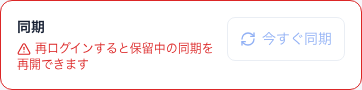
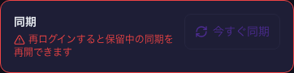
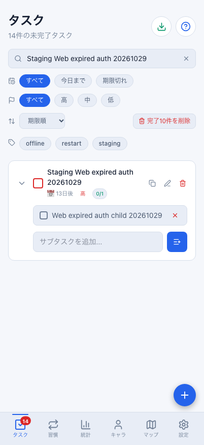
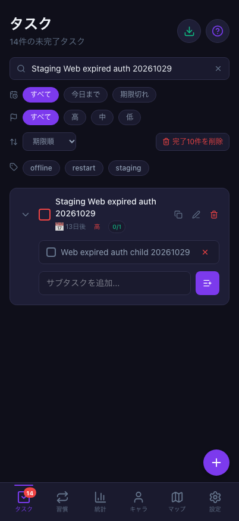

# Webの実期限切れJWTによる401と、再ログインでの保留操作復帰（2026-10-29 / #862）

計画④ [#699](https://github.com/YuTakane256/Life-Quest/issues/699) / T08のWeb限定確認。
実際に期限切れた検証用JWTを親RPC 1回だけに適用して実サーバーから401を返させ、
親子の操作を保持したまま通常UIの同一アカウント再ログインで復帰することを確認した。
**実行用SDKの有効セッション全体は置き換えていない。自然期限切れ起動・自動refresh失敗・refresh token失効の合格にはしない。**
アプリ・DB/API・保存形式・報酬計算の変更はない。

## 条件と準備時の中断

- main：`05bc926f96122b647d249b0f7f164907bae03499`（#861マージ後）。
  専用設定のWeb4175、既存の実行用Web profileと、承認済みの検証用アカウントAを使用した。
  fixtureは無効、SDKの所有者と接続先を確認し、開始時の実行用outboxは0件・同期はreadyだった。
- 別の既存staging-A profileを**アプリJavaScript無効**で読み、保存JWTの所有者・issuer・実際の期限切れを照合した。
  その保存領域にある古いfailed 1件は読み取りだけで保持し、アプリ起動・認証更新・再送・消去はしていない。
  認証値はメモリ内だけで使用し、コピーをファイル・チェックポイント・公開結果へ保存していない。
- 準備段階で、ブラウザの起動設定、ヘルパーの状態参照、重要度の要素指定を修正した。
  いずれも親タスクの送信前で、正式ケース開始前に対象親のDB不在と実行用キュー0件を確認した。
  中断した準備記録は非公開で保持し、親子を作り直して試験を成功扱いにはしていない。
- 予備診断では保存セッションの自然な期限切れも観察したが、起動時の自動更新を独立した完了試験として記録していない。
  以下の正式ケースと混ぜず、T08の自然期限切れ起動・SDK自動refreshは未確認として残す。

## 実401での停止

通常Webフォームから、未完了の親`Staging Web expired auth 20261029`と子`Web expired auth child 20261029`を各1件作成した。
親はhigh・期限2026-11-11・繰り返しなし。完了やゲームの報酬操作は行っていない。

fetch境界で、指定staging・当該親名の`upsert_task` 1回だけのAuthorizationを期限切れJWTへ差し替えた。
SDKの保存セッション、Auth/pull、ほかの要求、Mac全体の回線はそのままとした。
実サーバーはHTTP401と期限切れを示す応答を返し、その応答をアプリへそのまま渡した。
ローカルで偽の401レスポンスを作った試験ではない。

- 親は`pending`・`auth-required`、子も`pending`となり、同じ2操作が保存された。
  子の`dependsOn`は親の操作IDを保持した。failed/conflictとして破棄されていない。
- 設定の同期欄に「再ログインすると保留中の同期を再開できます」が表示され、「今すぐ同期」は無効だった。
- ログイン通知を発火させず、アプリの既存drain要求を出しても通信は1回のままで、保存2操作は変わらなかった。
  無効な同期ボタンを強制クリックしたり、キューや認証フラグを書き換えたりしていない。
- 本人RLS読み取りでサーバーの対象親は0件。作成・完了の報酬も増えていなかった。

## 通常UIの再ログインで復帰

試験用fetchを元へ戻し、通常UIでログアウトした。Aの保存outboxは2件とも元の操作ID・payload・依存・失敗情報のまま残った。
その後、通常フォームから同じAへログインすると、アプリの認証ライフサイクルが保留を再開した。
ヘルパーから直接notifyLoginを呼んだり、SDKへsetSessionしたりしていない。

| 対象 | 捕捉した応答 | 確認 |
| --- | --- | --- |
| 親upsert_task | 401 → 200 | 同じ操作キー・親ID。最初の要求は認証拒否で、再ログイン後に初めて保存 |
| 子upsert_subtask | 200の1回 | 元の子操作キー・子ID・親ID。親の復帰後に送信 |
| 通常の手動同期後 | 書込の再発なし | 同じ親1件・子1件、high・期限・未完了、DB行/version不変 |

再ログイン後のpending/inflight/failed/conflictはすべて0件だった。
今回の比較開始から終了まで390→390 XP、タスク消化数10、当日のタスクXP 0、装備1個、開封履歴2件、最高到達1で不変。
今回の親子をsourceとする報酬台帳は0件だった。

この401→200は、認証拒否された要求の復帰である。サーバー成功後の応答喪失や、成功済み操作の重複付与を調べたT07とは区別する。

## 匿名記録と画像

[識別子を除いた結果JSON](evidence/staging-web-expired-auth-20261029.json)には、JWT・資格情報・メール・URL・
ユーザー/親子のUUID・操作キー・生の通信/保存ログを含めない。
非公開の値を照合し、公開結果は件数と真偽値にした。

同期欄はアカウント情報を含めないよう、そのsection全体を要素単位で原本撮影した。
復帰後は今回作った検証用親子だけを検索した画面。配色は撮影用のブラウザ設定だけを切り替え、最後にlightへ戻した。

| 状態 | ライト | ダーク |
| --- | --- | --- |
| 401後の再ログイン案内・無効な同期ボタン（同期欄のみ） |  |  |
| 再ログイン後の親子タスク（Web 402×874） |  |  |

## 残る確認

- **T08は部分確認。** 実行用SDKを有効に保ち、親RPC 1回だけへ期限切れJWTを適用したWebの1ケースである。
- SDK全体の自然期限切れ起動、実際のrefresh失敗/refresh token失効、長時間切断からの復帰、Native/Android/実機は未確認。
- 別アカウントBへの切替や古い非同期応答の全パターンは、このケースで再確認したとはしない。
- 失敗済み操作の救済、既存failedの消去、DB初期化、認証設定・セッション有効期間の変更は行っていない。
- 検証データは保持。ブラウザcontextと今回の専用Webサーバーだけ終了し、Nativeと普段の環境は操作していない。
