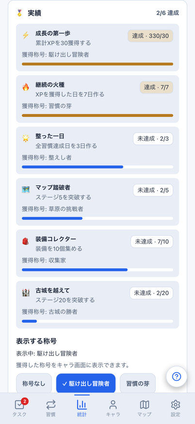
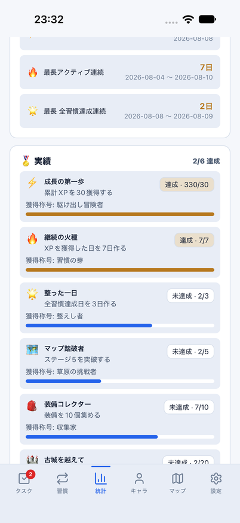
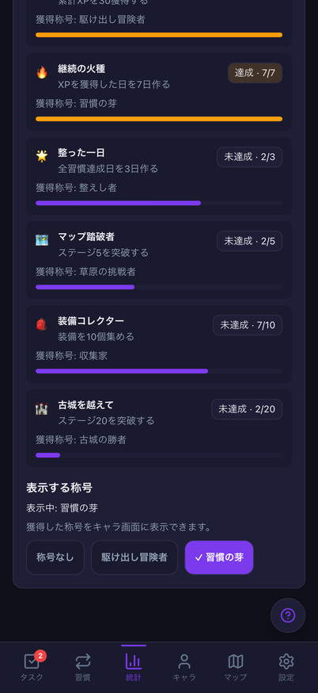
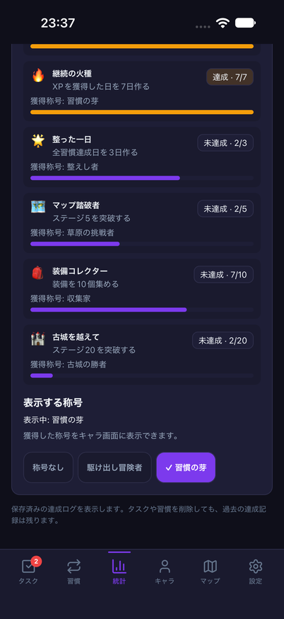
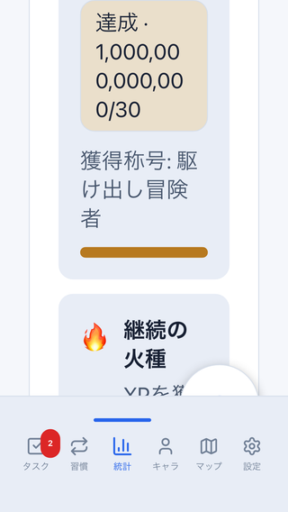
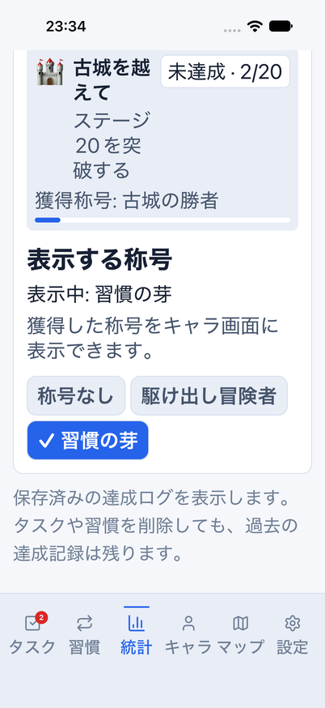

# 実績の全文表示・称号選択の品質確認

Issue: [#793](https://github.com/YuTakane256/Life-Quest/issues/793)。#791 / PR #792に続く、計画④の統計表示の改善。

## 変更

- Web/Mobileの全6実績で、名前・達成条件を1行省略せず表示する。
  現在値/目標、達成/未達成、獲得称号を分けて表示し、未達成時も次の目標が分かるようにする。
- 未達成行全体の透過をやめ、説明・状態を読みやすい色へ揃える。
  大きな数値と拡大文字ではラベルやバッジを折り返す。
- 進捗バーの数値範囲は0〜目標で保ち、読み上げ文には目標を超えた実数・達成状態・称号を含める。
- 称号を44px/pt以上のボタンから選べるようにし、色・チェック印・「表示中」で状態を示す。
  Webは押下状態、Nativeは選択状態をアクセシビリティに公開する。
  獲得済みだけを選択でき、未獲得では選べるようになる条件を案内する。
- 選択/解除は既存の称号storeへ渡し、キャラ画面の表示と既存の保存・同期送信を維持する。
  閲覧だけで称号・統計ログを書き換えたり、解放されていない保存済み称号を自動削除したりしない。

実績定義・解放条件・報酬量・DB/API/保存形式・同期処理は変更しない。
装備数などの現在値から導く既存仕様を保ち、実績の永続的な解放台帳を新設する変更ではない。

## 同条件の比較

架空の共通dailyデータ、固定日時、402×874、両テーマ。2/6達成、累計330XP、
7活動日、2全習慣達成日、ステージ2、装備7個を比較する。
OSステータスバー・スクロール位置・フォント描画は異なる。完全な画素一致とは扱わない。

| 状態 | Web | iOS |
| --- | --- | --- |
| light・実績一覧 |  |  |
| dark・称号「習慣の芽」を選択 |  |  |

下は同じデータの比較ではなく、異なる端末条件での品質検証。
Webは320×568/文字200%・全達成/1兆XPの架空値、iOSは402×874/accessibility-large・共通dailyデータ。

| Web・小画面/拡大文字/大きな数値 | iOS・拡大文字/称号選択 |
| --- | --- |
|  |  |

## 検証

- 全体テスト2,895件成功/98件skip。関連UI/称号store、保存・同期送信の既存回帰を含む。
- Web/Mobile/core型検査、build、check:secrets成功。lintはerror0/既存warning6件。
- Web E2E32件成功：PC/402px・両テーマ、全6実績の条件/進捗/称号、
  選択/解除の保存とキャラ画面への反映、320×568/文字200%・長い数値・全達成→空への更新。
  既存の日別統計・週間XP・自己ベスト・レスポンシブ操作も再実行する。
- 390×844の既存統計画像比較1件成功。基準画像・許容値を変更しない。
- iOSの通常light、accessibility-large/light、通常darkで、条件を読み、称号を選択し、
  キャラ画面への反映・統計へ復帰・称号解除を順に実操作して3フロー成功。
  ログは順に`2026-10-21_233104`、`2026-10-21_233342`、`2026-10-21_233630`。
  検証後、文字サイズを元の`large`へ戻し、専用8082とparityアプリを終了した。

専用`com.yutakane.lifequest.parity`、8082、クラウド設定なしのdailyメモリfixtureに限定する。
新しい`achievements`フローも、通常版/preview/クラウド設定あり/battle・rewards用データでは開始しない。
`clearState`や通常アプリのデータ消去は行わない。比較用データでの成功と実際の永続化試験は区別する。

Webの初回E2Eではテストが既存ナビゲーションをlinkと誤指定して停止したため、
実装どおりのbutton指定へ直して全件再実行した。アプリの動作不具合や成功件数には混ぜない。

## 残る範囲

今回の称号の実操作と、VoiceOver/TalkBackによる全画面の読み上げ確認は別である。
Android/実端末、実アカウントの同期・復元、署名済みpreviewは未確認の範囲として残す。
READMEの画像は増やさず、計画④の継続とする。⑤の内部配布やストア提出へは移行しない。

PR後はGPT-6.1 Sol・エフォート中の独立レビューと最終HEADのCI3つを確認し、マージしない。
