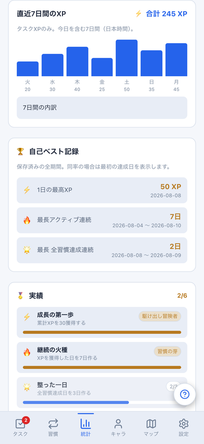
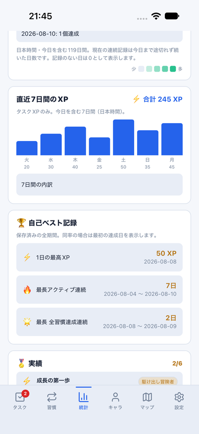
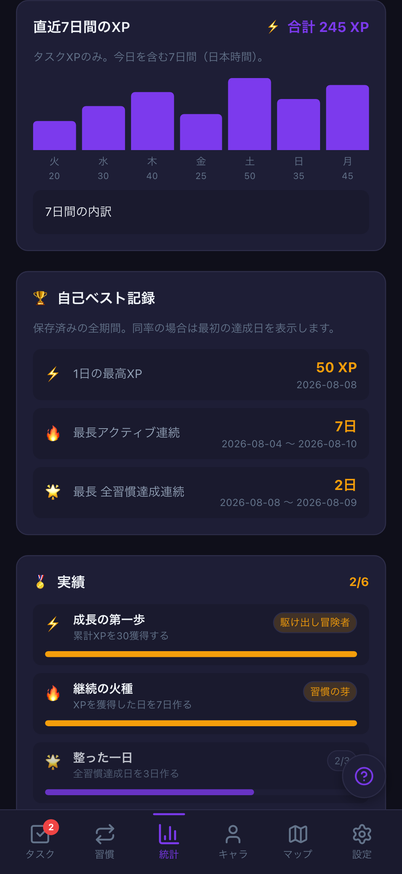
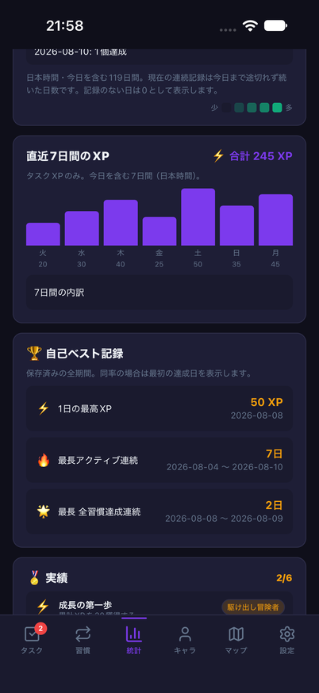
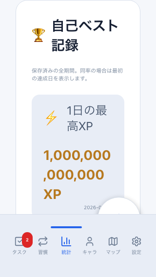
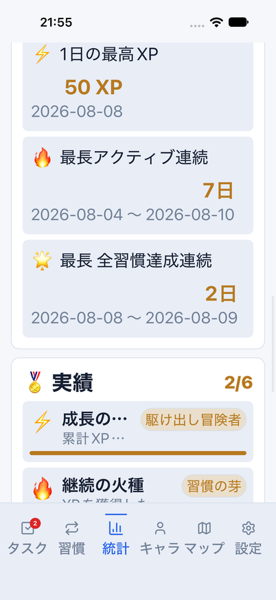

# 直近7日間のXP・自己ベストのWeb/Mobile統一

Issue: [#791](https://github.com/YuTakane256/Life-Quest/issues/791)。#789 / PR #790の日別統計に続く、計画④の振り返り表示。

## 変更

- Mobileに直近7日間のタスクXPグラフと合計、自己ベスト3記録を追加。
  ヒートマップ → 直近7日XP → 自己ベスト → 実績の順に揃えた。
  WebのDOMも表示順へ並べ、読み上げ/キーボード順だけが旧順になる状態を解消する。
- Webで「今週」と表示していたが、実際の集計は月曜始まりではなく今日を含む7日間だったため、
  両方とも「直近7日間のXP」とする。習慣モードにしてもタスクXPのグラフであることを明記。
  習慣・バトル等を含むキャラクター累計XPと混同しないようにする。
- 週間グラフ・曜日・自己ベスト・日付範囲を共有coreの純関数へ移し、保存済みログから導出する。
  自己ベストは119日とは別に保存済みログ全体を対象とし、同率は最初の達成日/区間で決定する。
  同じログを別順で同期/復元しても、同率の最高XPの日付が変わらない。
- 空の場合、週間XPは0、自己ベストは「—」と空の期間で表示する。
  ログの更新・消去、JST午前0時後の週間範囲更新を反映し、古い値を保持しない。
- 図の補助ラベルは小さく保ちつつ、全日付/実数の読み上げラベルと44pt/px以上の「7日間の内訳」を用意。
  内訳の文字は拡大に追従する。大きなXP値、自己ベストの日付範囲は切り捨てず折り返す。
  Webの既存サマリー数値も、文字200%と長い数値の組合せでページをはみ出さないよう修正する。

## 検証

- 関連4suite 91件成功：7日境界/年/うるう日、未記録、全期間のベスト、同率・挿入順、
  ログ非破壊、両UIの表示順・内訳開閉・モード・最新ログ/消去・日付更新。
- 全体2,888件成功/98件skip、core718件成功。
  Web/Mobile/core型検査、lint（既存6warnings/error0）、build、check:secrets成功。
- Web E2E24件成功（新規8件＋既存の日別統計12件/レスポンシブ4件）。
  PC/402×874・両テーマ、America/Los_Angeles TZ、320×568/文字200%、長い数値・ログ消去を確認。
- 既存390px統計の画像比較1件成功。基準画像・許容値を変更していない。
  他3画面の既存微差は[前回の切り分け](help-navigation-quality.md#390px既存画像回帰の切り分け)と分ける。
- iOSは固定parity ID、8082、クラウドなしのdailyメモリfixtureで検証する。
  通常文字/light、アクセシビリティ拡大文字/light、通常文字/darkの3フロー成功。
  成功ログは順に`2026-10-21_214250`、`2026-10-21_215403`、`2026-10-21_215706`。
  検証後は文字サイズを元の`large`へ戻し、専用8082とparityアプリを終了した。
  通常アプリのデータ消去、実アカウントへのログイン、通知許可要求は行わない。
- 初回UIテストでは、既存WebのCSS表示順とDOM順の違いを検出し、実装のDOM順も揃えた。
  さらに大きな数値/文字200%での横はみ出しを検出して修正し、24件すべてを再実行した。
  最初の失敗を成功数へ含めない。
- iOS拡大文字の初回2回は、内訳を開いた後の末尾行の自動探索で停止した。
  スクロールを細かくし、先頭行の展開確認・末尾行・自己ベスト各項目を順に確認する条件で再実行して成功。
  カード全体を一度に画面内へ収めることや、表示判定の許容率を下げることを合格条件にはしていない。

## 同じ条件の比較

共通の架空dailyデータ・固定時刻・402×874・両テーマ。スクロール位置、OSヘッダー・描画差は残す。
グラフの値（合計245 XP）と、自己ベストの50 XP/7日/2日・その日付を比較する。
新規ゲーム機能や報酬を追加したものではなく、既存ログの振り返りを両方で使えるようにしたもの。

| 状態 | Web | iOS |
| --- | --- | --- |
| light・7日間XPと自己ベスト |  |  |
| dark・7日間XPと自己ベスト |  |  |

下の行は同じデータでの見た目の比較ではなく、表示条件を変えた品質確認。
Webは320px/文字200%と1兆XPの架空ログ、iOSは402pt/アクセシビリティ拡大文字と共通dailyデータを使用する。

| Web・小画面/拡大文字/大きな数値 | iOS・拡大文字/自己ベスト |
| --- | --- |
|  |  |

## 境界と残る範囲

DB/API/保存形式/報酬量/統計ログの記録・同期経路/実績・称号の解放条件は変更しない。
通常データの初期化や、過去ログの修復・書換えも行わない。内訳の開閉は画面内だけの一時状態。
READMEの画像は増やさない。#791の変更により、前回残していた週間グラフ/自己ベストの主要表示差は解消する。
実績一覧・称号等の全状態、VoiceOver全面確認、Android/実端末、実アカウント/staging同期は別の残検証。
計画④の継続であり、⑤の署名済みpreview・内部配布・ストア提出へ移行した扱いにしない。

PR後はGPT-6.1 Sol・エフォート中の独立レビューと最終HEADのCI3つを確認し、マージしない。
