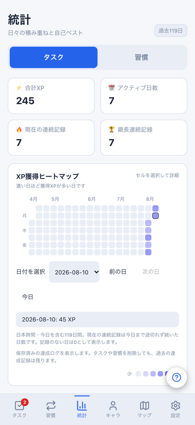
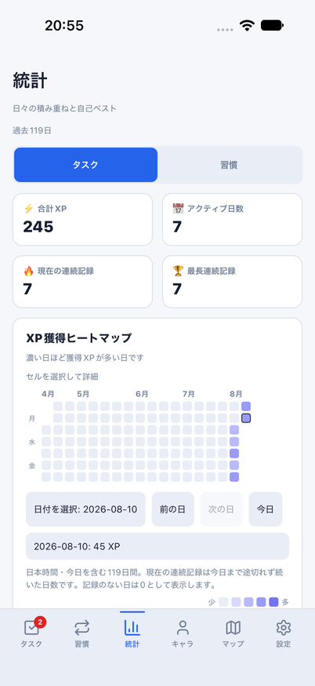
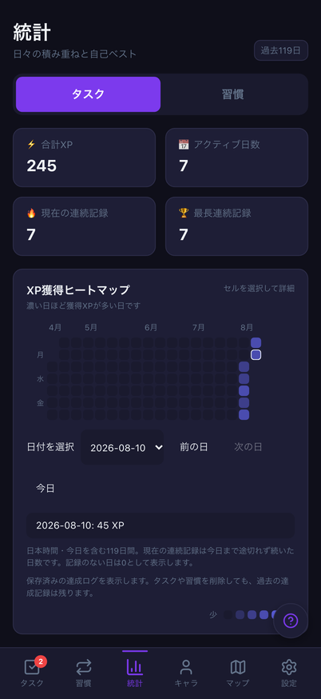
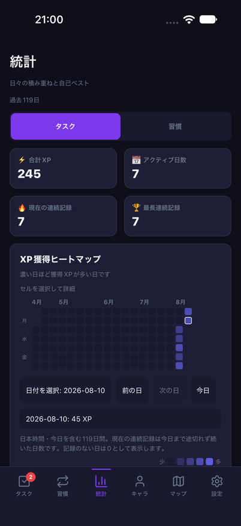
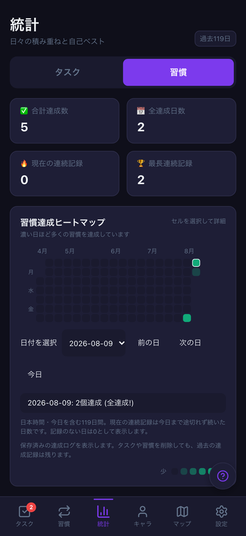
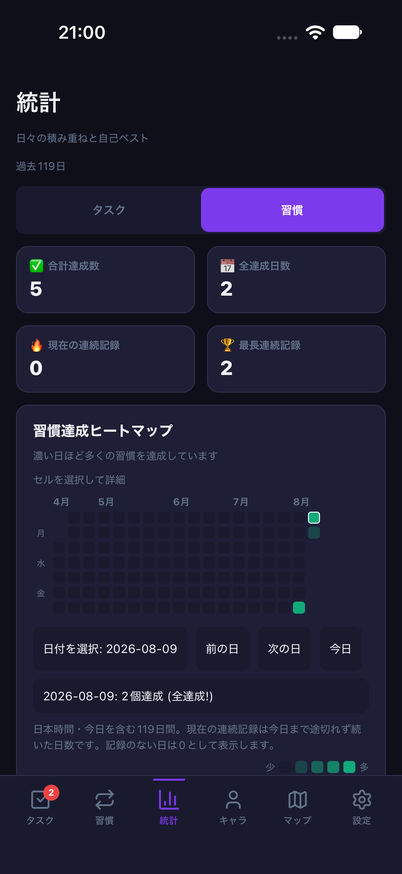
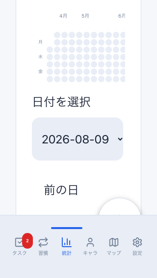
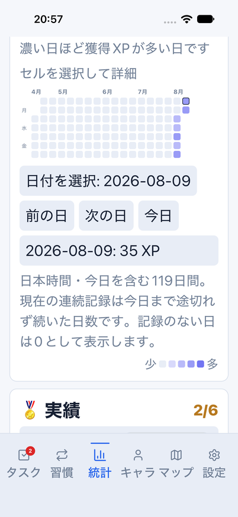

# 統計の119日集計・日別詳細・日本時間の日付更新

Issue: [#789](https://github.com/YuTakane256/Life-Quest/issues/789)。計画④の日常利用と表示条件の確認。

## 改善する範囲

- Webの119日とMobileの84日を、今日を含む119日に統一。サマリーは両方とも
  タスクの合計XP/アクティブ日数、習慣の合計達成数/全達成日数、現在/最長の連続記録とする。
  現在の連続記録は今日まで途切れない日数、最長は表示期間内の日数。未記録日は0として扱う。
- 既存の保存済み日別ログだけから共有計算する。現存タスクや習慣から再構築せず、
  削除後も過去の達成事実が残る。Mobileの「削除したタスクは集計に含まれない」という古い注記も修正。
- Mobileにも濃淡レベルではない実数の日別詳細とセル選択を追加。
  小さいマスを押せなくても、44pt/px以上の日付選択・前の日・次の日・今日で操作できる。
  Webは標準select、Nativeは全日付を並べた独立モーダルを用い、未記録日も選択可能。
- 日付選択後にタスク/習慣モードやログが変わっても、旧詳細文字列を保持せず現在値を導出する。
  未選択の「今日」は日付更新に追従し、明示選択した過去日は期間内にある限り保持。
  期間外へ出た場合は今日へ戻る。Nativeの選択画面はキャンセル/OSの戻る/タブ離脱で閉じる。
- JST午前0時、ブラウザーの前景復帰、Nativeのアプリ/タブ復帰で表示日を再確認する。
  背景/タブ離脱/アンマウントでは監視を止める。データを保存するタイマーは追加しない。
- Webの週間グラフの曜日を端末のローカルTZではなく暦日で計算する。
  Web/Nativeとも月ラベルとヒートマップを一緒に横スクロールし、小画面での位置ずれ/ページのはみ出しを防ぐ。

## 今回の検証

- 関連4suite: 80件成功。共有集計、欠損日/期間外/うるう年、JST時計の背景停止/復帰/cleanup、
  両UIの日付/モード選択、ログ更新・消去、データ非破壊、Nativeモーダルの閉じる/離脱を確認。
- 全体: 2,877件成功、98件skip。core: 711件成功。
  Web/Mobile/core型検査、lint（既存6warnings、error0）、build、check:secrets成功。
- Web: PC/402×874・両テーマ、320×568/文字200%の16件（既存responsive4件を含む）成功。
  タイムゾーンAmerica/Los_AngelesでもJST午前0時の表示更新・当日の曜日を検査する。
- 390pxの統計だけは、今回意図して追加した詳細操作/選択枠/列間隔に対応する基準画像を更新し、再比較1件成功。
  他画面の基準や許容値は変更しない。既存3画面の微小差は[前回の切り分け](help-navigation-quality.md#390px既存画像回帰の切り分け)と分けて扱う。
- iOS27/iPhone18Pro・light通常文字と`accessibility-large`、dark通常文字の3フローで実操作成功。
  実行ログは順に`2026-10-21_205452`、`2026-10-21_205654`、`2026-10-21_205942`。
  Simulatorの文字サイズは検証前の`large`に戻し、専用8082とparityアプリは終了した。
  実行は`npm run mobile:parity:screenshots -- stats`。固定parity ID・8082・local-only dailyメモリfixtureに限定する。
  通常版/サインイン済みデータのリセット、クラウド接続、通知許可要求は行わない。
- 初回はWebセレクタのナビとの同名競合、テスト時計停止前の遅延画面ロード、
  iOSの画面外にあるボタンを押すテスト条件で失敗した。成功扱いせず対象表示後に再実行した。
  文字200%でのWeb月ラベルの実際のはみ出しは実装側を修正した。

## 比較画像

架空の共通dailyデータ・固定時刻・402×874。上段のモード/サマリー/ヒートマップと、日別の実数を比較する。
OSヘッダー・フォント・絵文字の描画差、標準select/Nativeモーダルの違いは維持する。
Webの週間XP/自己ベストカードはMobileにまだ追加していないため、統計画面全体の完全一致は主張しない。

| 状態 | Web | iOS |
| --- | --- | --- |
| light・上段 |  |  |
| dark・上段 |  |  |
| dark・習慣の日別詳細 |  |  |

| Web・320×568/文字200% | iOS・402×874/アクセシビリティ拡大文字 |
| --- | --- |
|  |  |

## 残る範囲

計画④を継続中。⑤の署名済みpreview/内部配布には進めていない。
DB/API/保存形式/報酬量/統計ログの記録・同期方式・実績/称号の解放条件は変更しない。
週間グラフ/自己ベスト/実績一覧まで含む統計の全面統一、VoiceOverの全面確認、Android/実機、
stagingの双方向同期・実アカウント認証は後続に残す。READMEの画像は増やさない。

PR後はGPT-6.1 Sol・エフォート中の独立レビューと、最終HEADのCI3つを確認し、マージは行わない。
