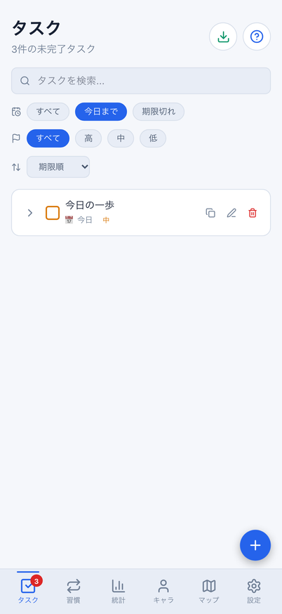
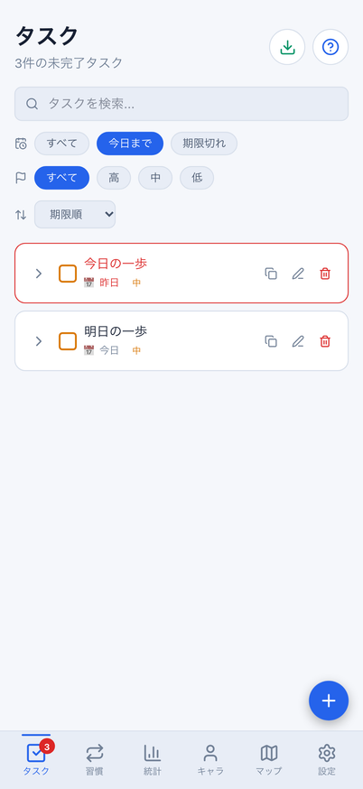
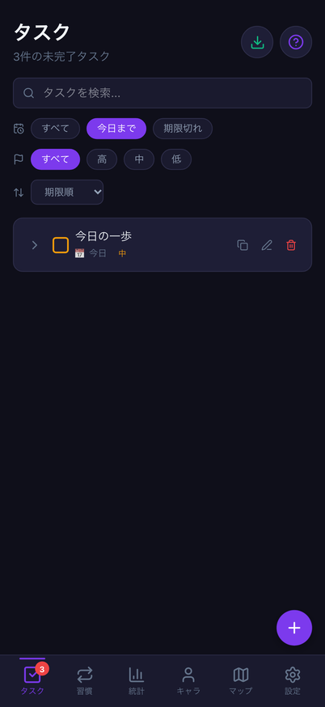
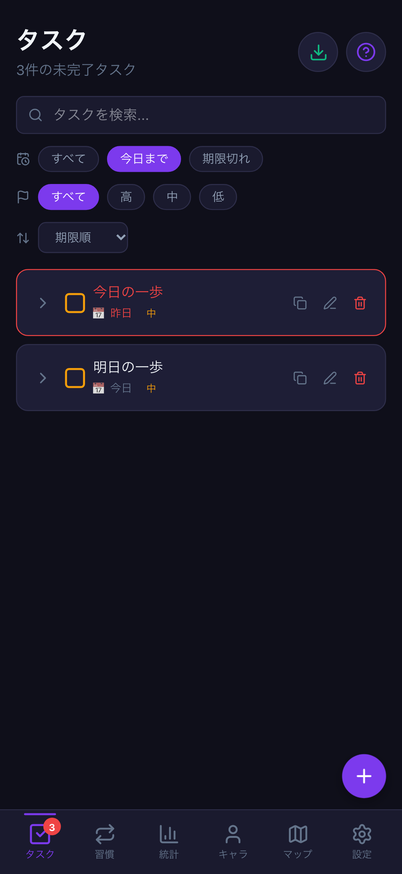
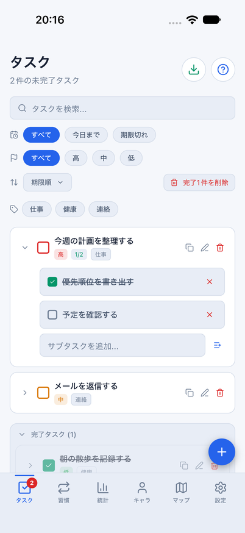
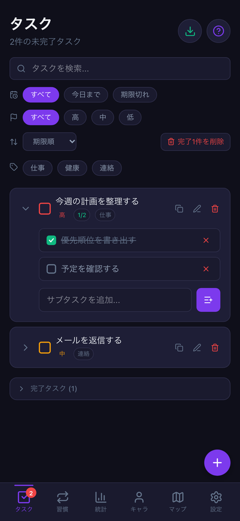
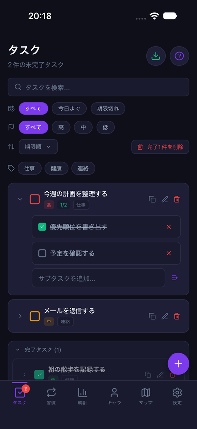

# タスク一覧の日付変更・前景復帰

Issue: [#801](https://github.com/YuTakane256/Life-Quest/issues/801)。計画④の日常利用品質の続き。
AI連携はまだ実装せず、「開いたときに今日やることを正しく確認できる」既存導線を改善する。

## 原因と変更

- Webは期限の絞り込みをmemo化していたが、今日の日付が依存配列になく、日付を更新する時計もなかった。
  Nativeも描画時に日付を取得するだけで、表示中の午前0時やアプリ復帰だけでは更新を保証できなかった。
- 統計で使用している既存の`useJstToday`をタスクにも利用する。JST午前0時とWebのfocus/visibility復帰、
  Nativeのタブ/アプリ復帰で表示日を更新する。非表示/タブ離脱時には既存hookがタイマーを停止する。
- Webの「今日まで」「期限切れ」・行の色・相対日付に、同じ描画の基準日を渡す。
  `isOverdue`と`formatRelativeDate`の既存呼出しは、省略時に現在のJST日付を使う仕様を維持する。
- 日付更新は表示だけ。検索/期限/優先度/タグ・入力中の下書き・完了待機/Undoを初期化しない。
  Nativeの実際のタブ離脱で一時入力をリセットする既存仕様とは区別する。

DB/API/保存形式/報酬量/繰り返しタスクの生成ルールは変更しない。
CSVファイル名は操作時の最新日付を使う既存仕様を維持する。習慣等の別画面や通知時刻、
実端末の時計変更、クラウド同期の合格、計画⑤への移行は今回の対象ではない。

## 検証

- 対象4ファイル164件成功。タスク画面の新しい境界14件を含む。
  実Web/Native画面・実store、JST午前0時、前景/タブ復帰、保存/送信不変、下書き/検索/Undo維持を検査する。
  hook単体のStrictMode/タイマー/リスナー解放と、日付関数の明示基準日も確認する。
- Native描画/OS/ストレージ/通信先はテストで置き換える。旧削除テストのfocus mockも、
  複数のhookを登録/解除できるようにし、古いAlertを拒否する検査自体は維持する。
- Web E2E24件成功。今回の12件と既存の完了/複製Undo・編集済み複製・CSV12件。
  両テーマ、既存2プロジェクトで実行し、日付境界は402×874に明示的に揃える。
  テスト用ブラウザー内の時計だけを進め、Mac/iOSのシステム日時は変更しない。
- 全体3,024件成功/98件skip、core749件成功。Web/Mobile/core型検査、build、秘密情報検査成功。
  lintはerror0/既存warning6。最終ソースで再実行した結果を記載する。
- 390px画像比較は7件成功/1件失敗。タスク画面の既知のselect矢印19px差分が残る。
  実画像SHA-256は`bf452f819c3595e4bf8e9962402038350ad8b950df969e2082100f813aae9cf3`で、
  前PRのbase検証画像と完全一致。今回の回帰ではないが成功扱いにはしない。基準画像/許容値は変更していない。

## Webの日付境界

期限が8/10、8/11、期限なしの架空3タスク。「今日まで」を維持したままJST 8/10 23:59:59→8/11 00:00:00。
新しい期限対象が追加され、昨日/今日の表示と期限切れの色が切り替わる。
表示された件数の変化は、保存タスクの追加/変更ではない。テストで保存タスクと成長値の不変を確認する。

| テーマ | 日付変更前 | 日付変更後 |
| --- | --- | --- |
| light |  |  |
| dark |  |  |

## iOSの通常操作回帰

既存の`taskList`フローを使用する。専用parity ID/8082/クラウド未設定/dailyメモリfixtureのみ。
完了→取消、複製→取消、検索、CSVのOS共有画面を開いて閉じる、タブ復帰を確認する。共有先へ送信しない。
固定時計のfixtureなので、このiOS実行を午前0時の実操作や実データ永続化の証拠にはしない。
日付境界は上記の実画面自動テストで別に確認する。
light（`2026-10-22_201336`）は全フロー成功。darkは確認後に追記する。

次の比較は共通の元のdailyデータ・固定日時・402×874、完了/複製を取消した後の状態。
上の日付境界専用データとは異なる。OSヘッダー/スクロール/フォント描画の差は残る。

| テーマ | Web | iOS |
| --- | --- | --- |
| light |  |  |
| dark |  |  |

最終HEADのCI3件と6.1 Sol・中の独立レビューでマージ可否を判定する。自動マージはしない。
