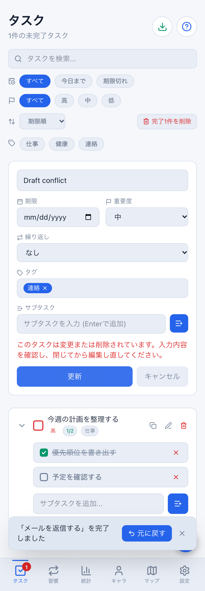
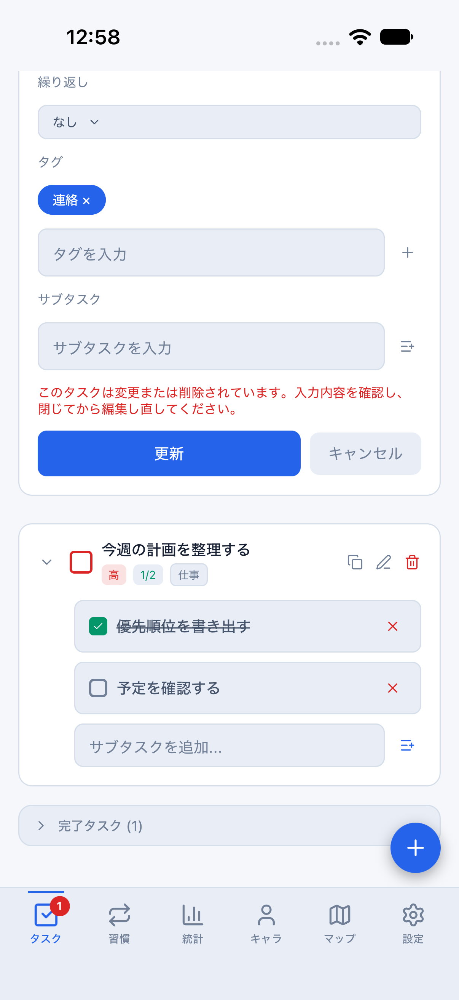

# タスク作成・編集フォームの帰属と競合確認（#771）

計画④の日常操作・データ保護として、Web/Mobileのタスク入力を確認します。
前回の繰り返し編集・キーボード対応に続くまとまりです。

## 修正

- ログアウト、別アカウント切替、ログアウト後の同一アカウント復帰で未保存入力を破棄。
  匿名から初回ログインした際も未保存下書きを自動で持ち込みません。保存済み匿名データの移行処理は変更しません。
- Webの画面破棄、Mobileのタブ離脱、取消・再編集で旧保存/取消callbackを無効化。
  再描画前の認証切替でも送信しません。二重保存も防ぎます。
- 同一ユーザーのセッション更新通知と同値pullでは現在の入力を維持します。
- 編集開始時のタスク値を固定し、保存直前に現在のローカル値と比較。
  変更・削除・完了・サブタスク追加等があれば上書き/送信せず、下書きを残して
  「閉じてから編集し直してください」と表示します。別タスクの変更は妨げません。

この比較はローカルの古い入力を検出するものです。サーバーのrevision排他制御や、
別端末の同時書き込みの競合解決を新設するものではありません。Mobileストアの
サブタスク差分保存は維持しますが、本フォームは競合時に自動マージせず再編集を求めます。

DB・API・保存形式・報酬量は変更しません。フォームを開く/取消/競合エラーだけでは
報酬・次回タスク・クラウド操作を発行しません。

## 自動回帰

```bash
npx vitest run src/hooks/taskDraftSession.test.tsx packages/core/src/taskEditGuard.test.ts \
  src/hooks/mobileTaskRecurrence.test.tsx src/hooks/completedTaskDeletion.test.tsx \
  scripts/run-mobile-parity-screenshots.test.mjs
npx playwright test e2e/task-draft-quality.spec.ts e2e/task-recurrence.spec.ts \
  --project=desktop-chromium --project=mobile-chromium
```

Nativeは実画面コンポーネントと実ストアを使い、OS/UIのみモック化。認証切替・再描画前・
取消/再開・二重保存・同値pull・編集競合・タブ離脱を検査します。Webは両テーマ・PC/402pxで、
編集中に一覧の完了操作→更新拒否→下書き保持→取消→再読み込みで完了の維持→新規追加を確認します。

## iOSの再実行

通常Metro8081を止めず、8082にクラウド未設定・メモリ専用daily比較環境を起動します。

```bash
npm run start:reference:light --workspace @life-quest/mobile -- --port 8082
node scripts/run-mobile-parity-screenshots.mjs taskDraft
```

darkは8082のみ停止し`start:reference:dark`で再実行します。runnerはparity・local-only・daily・
両テーマの前提を検査し、通常データのclearStateを行いません。編集対象の削除後の更新拒否、
取消、新規入力後のタブ離脱・復帰での破棄を確認します。メモリfixtureなので永続化・
実アカウント同期の合格証拠にはしません。検証後は通常の8081へ戻します。

```bash
xcrun simctl openurl booted 'lifequest-parity://expo-development-client/?url=http%3A%2F%2F127.0.0.1%3A8081&disableOnboarding=1&disableAutoLaunch=1&disableFab=1'
```

## 実行結果と残項目

2026-10-19: WebはPC/402px・light/darkの8ケース（繰り返し編集の既存回帰を含む）が成功。
iOS lightの競合・タブ離脱フローも全操作が成功しました。最初のブラウザー起動は
マージ済みPlaywrightに対応するChromiumが未取得だったため失敗し、取得後の再実行で成功しています。

Webは「編集中の完了」、iOSは「編集中の削除」を使った別の競合シナリオです。
同条件のピクセル比較ではなく、同じエラーと取消導線を確認する操作証拠です。

| Web light | iOS light |
| --- | --- |
|  |  |

最終HEADのCI・独立レビュー・操作画像はPRに記録します。一覧内の直接操作・習慣/メモ等の全入力の境界保護、
全画面の文字拡大、小画面、Android実機、staging双方向同期・認証/通知は別の確認です。
今回の変更で④全体を完了扱いにはしません。
