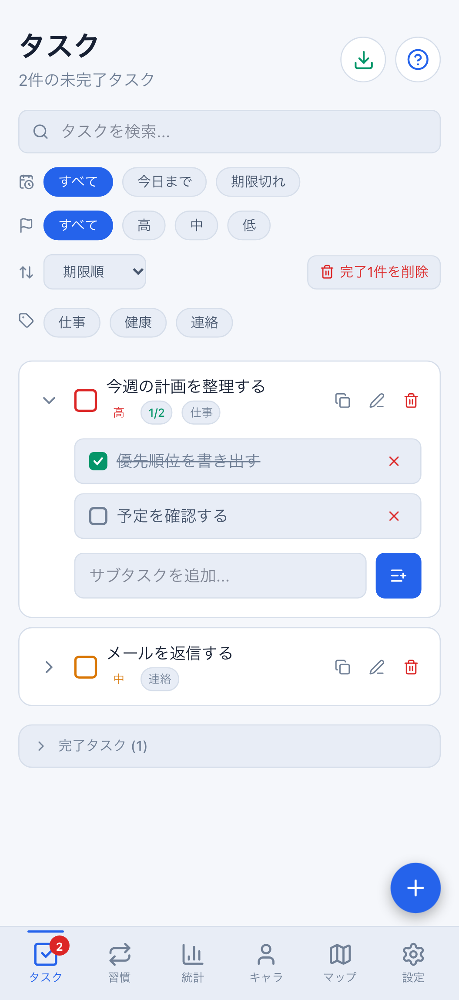
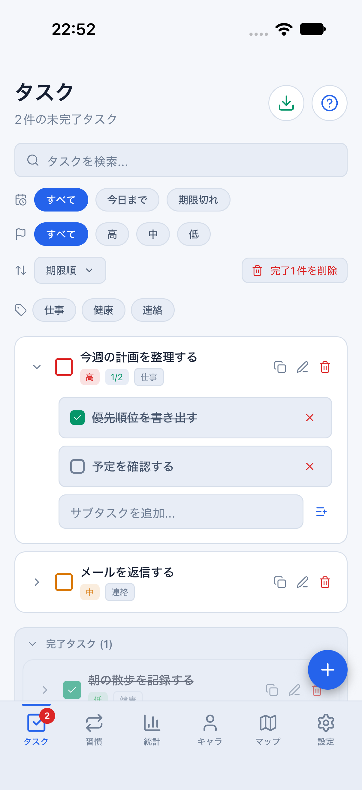
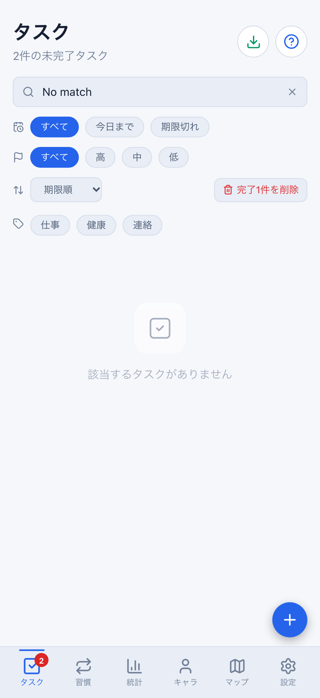
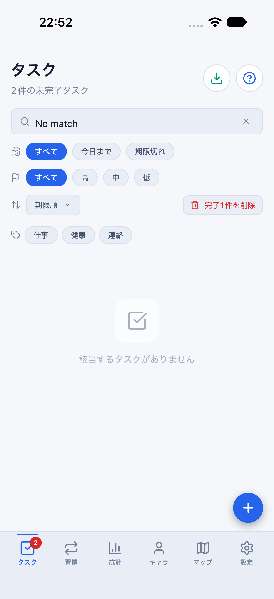
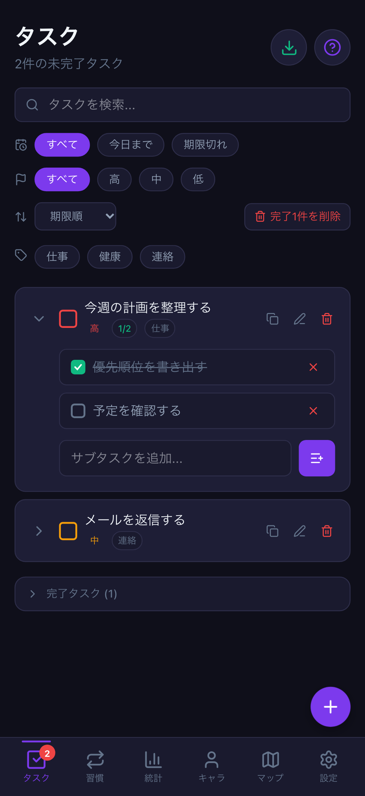
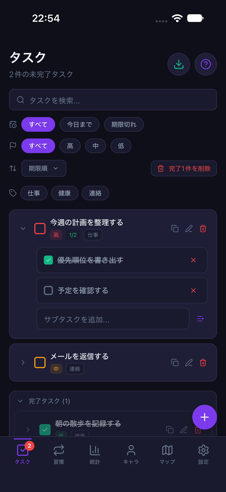
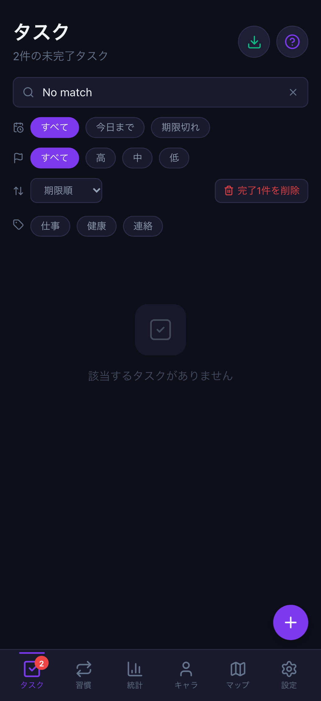
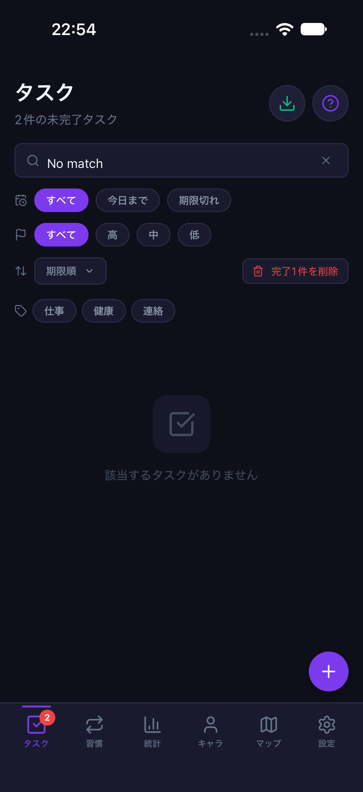

# タスク一覧の操作・Undo・CSV/検索（#779）

計画④の関連する3点を一つのまとまりにします。新機能の追加や報酬計算の変更ではありません。

## 1. 完了・複製・編集・展開の操作帰属

描画した親タスク全フィールド・子タスク状態を`captureTaskEdit`で固定し、実行直前の状態と照合します。
対象変更/削除、認証切替、画面のアンマウント、Nativeタブ離脱後の旧行では操作しません。
同じコールバックの重複実行も防ぎます。再描画後にユーザーが改めて押す操作を一律に抑制するdebounceではありません。
Nativeは復元前に完了・複製や、その成功を示すUndoを表示しません。

## 2. 対象を限定したUndo

- 複製Undoは未変更の複製だけを削除します。編集・タグ・サブタスク・完了状態等の変更後は保持し、同じ画面なら理由を案内します。
- 完了Undoは開始したときと同じ待機オブジェクトだけを取り消します。後から作り直した完了待機を古い通知で取り消しません。
- 認証の世代も固定し、別アカウントやログアウト後の同IDデータには作用しません。
- Undoは行のタップとは別の明示操作です。同じ認証/対象であれば画面移動後も既存の通知から取り消せます。
  既存Provider/hookの5秒期限・一度限りの処理は維持します。

値比較はローカルの楽観的保護です。サーバー排他制御や、変更後に完全に同じ値へ戻った履歴の識別ではありません。

## 3. CSVと検索・絞り込み

- 操作時の最新の全タスクからCSVを作成します。表示の検索・絞り込みに関係なく全件を書き出す既存仕様は維持します。
- Webは`.csv`ダウンロード。失敗時は再試行を案内し、クリック失敗時も作成済みBlob URLを解放します。
- Nativeは既存どおりCSVテキストをOS共有画面へ渡します。共有中の重複開始を防ぎ、失敗/終了は開始した操作と画面にだけ反映します。
  別アカウント/別画面の新しい共有を、古いPromiseの終了で解除したり、古い失敗通知で邪魔したりしません。
- 共有を開始した後にOS側へ渡した内容を撤回したり、OS共有画面そのものを強制終了したりする機能ではありません。
- 認証切替で検索・期限/優先度・タグを初期化し、旧フィルター入力も拒否します。同一ユーザー通知・同値pullは保持します。
  Nativeタブ離脱でも一時的な検索等を初期化します。テーマや並び順の好みを初期化する変更ではありません。

DB・同期API・保存形式・報酬計算・通常保存データの初期化は変更しません。

## 検証

- `src/hooks/taskListActions.test.tsx`：64件。実Web/Native画面・ストア、保持した実際の旧コールバックで検証。
  行の重複実行、認証の再描画前切替、複製編集後Undo、完了待機の作り直し、Native復元待ち・タブ復帰を確認します。
  CSVの最新データ、Blob解放、共有Promiseの順序逆転、共有中の重複開始、フィルターの初期化/保持も検査します。
- 既存の実Provider/hookによるUndo期限・認証切替の回帰も維持します。
- Web：PC幅・402×874、light/darkの12ケース。
  通常の完了/複製Undo、編集済み複製の保持と再読込、実ダウンロードしたCSVのファイル名/全件内容を検証します。
  初回読込完了後にテスト時計を止め、編集Undoが5秒期限内であることを明確にします。期限切れは別の既存回帰で検査します。
- iOS Simulator：iPhone 18 Pro / iOS 27 / 402×874、共有daily fixture・light/dark。
  通常の完了/複製Undo、検索、OS共有画面の開閉、タブ復帰時の検索初期化を確認します。
  OS共有先への送信や、メール/クラウドへの保存は行いません。
- 画像/Native操作は2026-08-10の架空匿名データ、8082のクラウド未設定・メモリ専用parity環境です。
  通常の確認用Metro8081とユーザーの保存データは変更しません。

## 同条件画像

完了/複製をUndoした後と、同じ「No match」で検索した状態を比較します。
OSステータスバー・スクロール位置・書体の微差は比較対象外です。

| 状態 | Web 402×874 | iOS 402×874 |
| --- | --- | --- |
| Undo後・light |  |  |
| 検索中・light |  |  |
| Undo後・dark |  |  |
| 検索中・dark |  |  |

## 再実行

```sh
npx vitest run src/hooks/taskListActions.test.tsx src/components/ui/taskUndoSession.test.tsx
npx playwright test e2e/task-list-actions.spec.ts --project=desktop-chromium --project=mobile-chromium
npm run mobile:reference:light -- --port 8082
# 別ターミナル。darkは上の一時サーバーだけ終了してmobile:reference:darkへ切り替える
node scripts/run-mobile-parity-screenshots.mjs taskList
```

全画面・Android実端末・stagingでの双方向同期・署名付き認証/通知の確認が完了したとは扱いません。
