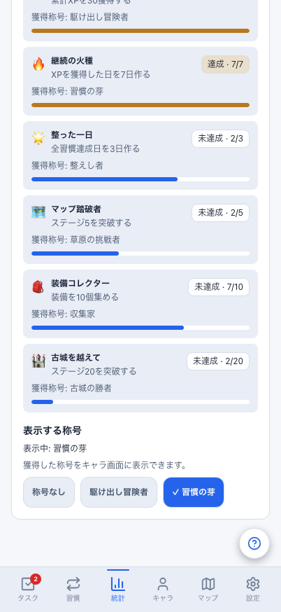
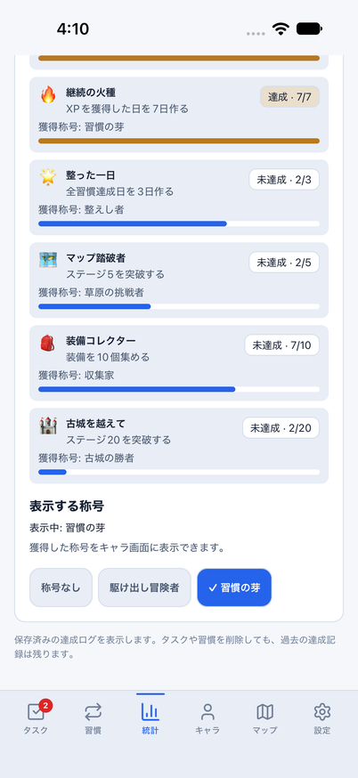
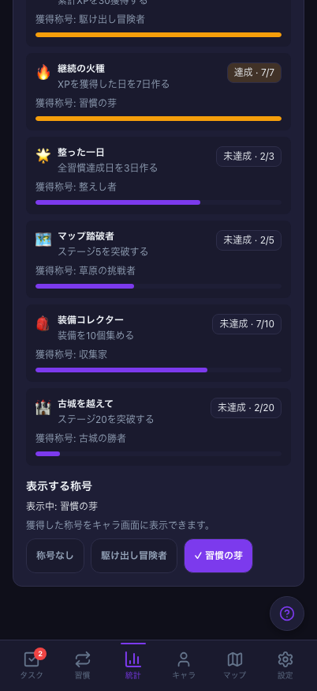
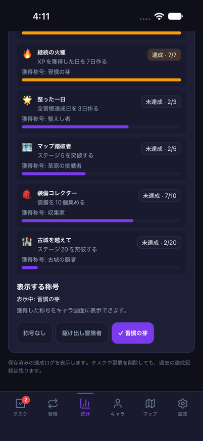

# 称号選択の認証・画面・最新実績境界

Issue: [#817](https://github.com/YuTakane256/Life-Quest/issues/817)。計画④の品質確認。
#793の実績表示・称号選択に、既存の認証/画面スコープを適用する。

## 問題と変更

Web/Mobileの称号ボタンが直接storeへ保存しており、再描画前にログアウト・別ユーザーへの
切替・ログアウト後の同一ユーザー再ログインが起きても、古い画面の操作が保存された。
実storeを使うテストで修正前の6ケースを再現し、いずれも失敗することを確認した。

- 共通の`captureTitleSelection`で、画面に提示した候補と生の保存済み称号を捕捉する。
  実行直前に認証/画面寿命、最新の実績条件、最新の保存済み称号を照合する。
- ログアウト/切替をまたいだ選択・解除、最新実績で未獲得の候補、同期で別の称号に変わった後の
  上書きを拒否する。Mobileではタブ離脱/再表示、画面破棄、ゲーム/統計の復元待ちも拒否する。
- 1つの描画からは1回だけ保存し、同じ値の再選択や、すでに「称号なし」の解除は保存しない。
  実際に選択した時だけ、既存storeと`upsert_profile`送信経路を利用する。
- 同一ユーザー通知、同値のpull、選択候補に関係しない進行変更は許可する。
  古い操作を拒否した後も、新セッション/復元後の新しいボタンは通常どおり使える。
- 閲覧だけで未獲得の保存済み称号を消さない。最新状態で称号候補がなくなった場合、古い解除も拒否する。

実績条件・報酬・DB/API・同期送信の帰属処理・保存形式は変更しない。
競合するクラウド書込み全般のバージョン解決ではなく、画面から発生する古い入力を防ぐ変更である。

## 同条件の画面確認

共通daily架空データ、固定日時、402×874、2/6達成、選択「習慣の芽」。
OSのsafe area、文字描画、スクロール位置、Web専用ヘルプ入口の差は残す。
今回はレイアウト変更ではなく、操作の安全性と既存の表示維持を確認する。

| テーマ | Web | iOS |
| --- | --- | --- |
| light |  |  |
| dark |  |  |

## 検証

- 全体単体テスト3,228件成功/98件skip、core単独770件成功。
  追加した共通ヘルパー15件と、Web/Mobile実store・StrictMode・認証切替の25件を含む。
  無効操作で称号保存/同期送信がないこと、通常操作の正しい送信内容、統計/ゲームデータの不変を確認する。
- 関連UIを含む61件成功。Web/Mobile/core型検査、build、check:secrets、release設定検査成功。
  lintは既存warning6件/error0。
- Web関連E2E28件成功。PC/402px・両テーマ、選択/解除/キャラへの反映、
  同値操作での保存回数不増加、小画面/文字200%・空/全達成・長い値を確認する。
- 402×874の称号選択画像2件、390×844の既存統計画像比較1件成功。
  既存の画像基準や許容値は変更しない。
- iOSの通常文字light/darkで、実績の条件確認→称号選択→キャラへの反映→統計に戻る→解除の
  2フロー成功。ログは`2026-10-24_040901`、`2026-10-24_041102`。
  専用8082とparityアプリを終了し、文字サイズ`large`を維持した。通常の8081には触れていない。

Web E2Eの初回では、fixtureの初期称号が設定済みであるのに「解除の保存は0回」と
テストで誤って期待した。初回解除は1回、その後の同値操作は追加0回と修正し、28件を再実行した。
アプリ不具合や成功件数には混ぜない。390px比較の初回はgrepの指定誤りで0件のため、
実際のテスト名で再実行した1件だけを成功として数える。

## 境界・残確認

画面画像とiOS操作は専用parityアプリ、8082、クラウド未設定のdailyメモリfixtureに限定する。
通常/preview/サインイン済みのデータ投入・削除は行わない。
実アカウントの同期/オフライン、Android/実端末、VoiceOver/TalkBack全画面、
署名済みpreviewは別の残項目。計画④を継続し、⑤の内部配布/ストア提出には進まない。

PR後、GPT-6.1 Sol・エフォート中の独立レビューと最終HEADのCI3ジョブを確認する。自動マージしない。
