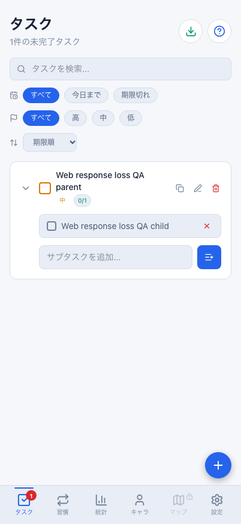

# Web起動時に認証更新の成功応答が失われた場合の同期復帰（2026-11-25）

計画④ [#699](https://github.com/YuTakane256/Life-Quest/issues/699) のR3／T08。前回の[Authに届く前の切断](web-auth-refresh-retry-20261124.md)に続き、Authが更新を受理したあと、ブラウザーが成功応答を受け取れなかった場合を確認した。検証したmainは `47e63797d87c9a83dff0e142cdee2baeddbbe203`。専用Chromiumプロファイル（402×874）とローカルSupabaseを使用した。ローカルAuthのJWT有効期間は180秒、更新トークンのローテーションは有効、再利用間隔は10秒。

1. 検証アカウントAでログインした。対象の同期通信を止め、通常の画面から親タスクとサブタスクを各1件作成した。DBは各0件で、保存済みの2件には親を先に送信する依存関係があった。この状態でChromiumを閉じ、JWTの期限切れを待った。
2. 新しいChromiumプロセスで起動し、SDKからの最初の更新要求をAuthへ転送した。AuthがHTTP 200で新しい更新トークンを発行したことを中継で確認し、ブラウザーに応答ヘッダーを送る前に接続を閉じた。復旧までは、それ以降の更新要求をAuthに届く前に遮断した。認証確認中は待機画面が表示され、退避前の親子の名前はDOMで検出されなかった。有効期限を過ぎたアクセストークンを含む元のセッション、保留2件、受信カーソルは保持され、対象同期RPCは0件だった。比較アカウントBを含むDBの観測対象も変わらなかった。
3. 初回の更新成功から10秒を超えて接続を戻すと、SDKが元の更新トークンを自動で再送した。AuthはHTTP 200と、初回の失われた応答に含まれていた更新トークンを返した。その成功応答のアクセストークンを使い、元と同じ操作キー・行IDで親、子、受信の順に成功した。同じページが再ログイン、再読み込み、手動同期なしで復帰した。トークンは中継のメモリ内で比較し、公開記録には比較結果だけを残した。
4. AのDBには未完了の親子が各1件、Bは各0件。両者のXPと報酬台帳は開始時と一致した。ブラウザーの保留は0件、受信カーソルは子の版まで進んだ。親子が表示され、設定は「同期済み」になった。

| 起動時に認証を確認している間 | 自動更新・同期後 |
| --- | --- |
|  |  |

[テスト用の識別子と認証情報を除いた照合結果](evidence/web-auth-refresh-response-loss-20261125.json)を添付する。認証・起動時の表示保護・アカウント分離・ローカルSupabase同期の関連テストは10ファイル191件が成功した。型検査とLintも成功した（Lintは既存の7件の警告）。

今回は起動時の更新成功応答が1回失われる条件を、Web版のChromiumとローカルSupabaseで確認した。更新成功応答の連続喪失、処理中の同期操作を伴う期限切れ、端末の全回線断、他のブラウザーとstagingは引き続き確認する。
