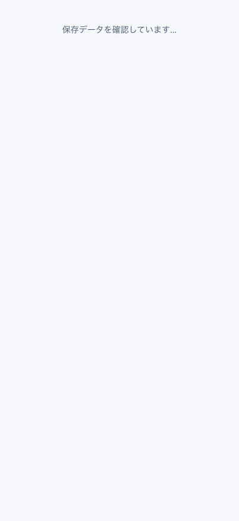
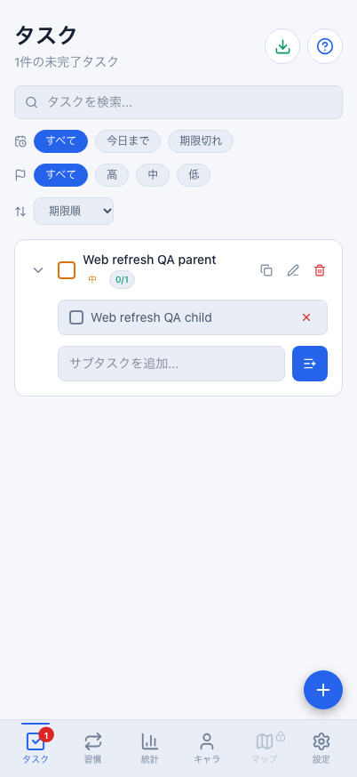

# Web起動時のクラウド表示を保護し、認証の一時障害から自動で復帰する（2026-11-24）

計画④ [#699](https://github.com/YuTakane256/Life-Quest/issues/699) のR3／T08。main `5af6cd47382469045d50222fc65c3fe2c9bd251d` を、専用Chromiumプロファイル（402×874）とローカルSupabaseで検証した。ローカルAuthのJWT有効期間は180秒。比較用のアカウントBもローカルに用意し、ChromiumはAで操作した。

修正前は未送信の親子が最終的に同期した一方、Authの確認が終わる前に保存タスク名をDOMで検出した。修正では、クラウド由来の保存マーカーがある起動で通常画面のマウントを待ち、認証が確定するか保存済み表示を退避したあとに開く。パスワード再設定中はアカウントフォームだけを表示し、更新・キャンセルの前に必要な退避を行う。以下は修正後のコード `37d6964382fca86730855462bb00b40342a9967e` で再検証した結果。

1. Aで通常ログインし、ローカル中継で対象の同期通信を止めた状態で画面から親子タスクを各1件作成した。DBは各0件で、ブラウザーにはAの未送信2件と親を先に送る依存関係が保存された。その状態でChromiumを終了した。
2. 保存済みJWTが実際に期限切れになってから別プロセスで起動した。更新トークンを無効化せず、起動時の更新要求だけをAuthに転送する前に切断した。Chromiumは更新の通信エラーを検出し、保存中のセッション情報とキューを保持した。表示の確認中は保護画面が開き、元のタスク表示が退避されるまで今回の親子タスク名はDOMで検出されなかった。対象の同期RPCは0件、両アカウントのDBは開始時と一致した。
3. 更新への接続を戻すと、同じブラウザープロセスのSDKがHTTP 200で認証を更新した。再ログイン、ページの再読み込み、手動同期なしで、更新応答のJWTを使って親・子の順に送信し、その後の受信も成功した。元の操作キーと行IDを照合した。
4. AのDBに未完了の親・子が各1件、Bは各0件だった。両アカウントのXPと報酬台帳は開始時と同じで、ブラウザーの保留は0件、受信カーソルは子の版まで進んだ。画面に親子が再表示され、設定は「同期済み」と表示された。

| 認証を更新できない間 | 自動更新・同期後 |
| --- | --- |
|  |  |

[認証情報・識別子を除いた照合結果](evidence/web-auth-refresh-retry-20261124.json)を添付する。Edge Functionの起動を確認してから、起動表示・再設定・アカウント分離・実DB同期の関連テストを実行し、8ファイル231件が成功した。

表示保護はクラウド由来と判定できる保存状態を対象にした。所有者の証拠がない壊れた保存データ、別ブラウザー、実際のパスワード再設定メールは今回の実ブラウザー試行に含まれない。今回の通信障害は更新要求がAuthに届く前の切断に限った。Authが更新を受理したあとの成功応答喪失、処理中の同期操作を伴う期限切れ、端末の全回線断、stagingでの同条件は引き続き確認する。
