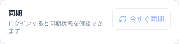
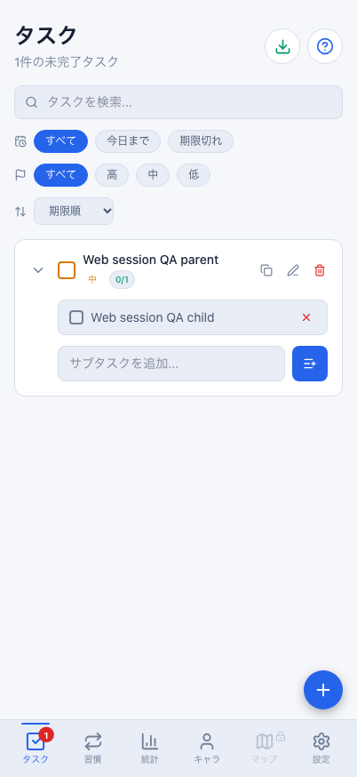

# Webで期限切れ起動後に元のアカウントの未送信タスクを復旧する（2026-11-23）

計画④ [#699](https://github.com/YuTakane256/Life-Quest/issues/699) のR3／T08。main `f51b0e271ebdc85576f61cf03091a2d7505a0e21` を、専用Chromiumプロファイル（402×874）とローカルSupabaseで検証した。ローカルAuthのJWT有効期間は180秒。別々の検証用アカウントA・BはWebでの初回移行済みで、初期状態のタスクとサブタスクはいずれも0件だった。

1. Aで通常ログインし、対象の同期要求を中継で切断した状態で、フォームから親子タスクを各1件作成した。親子はDBに未登録で、ブラウザーにはAの未送信操作2件と親を先に送る依存関係が保存された。その状態でChromiumを終了した。
2. ローカルAuthでAの更新セッションを無効化した。保存JWTの実期限を過ぎてから同じプロファイルを別プロセスで開くと、SDKの起動時更新にAuthがHTTP 400（`refresh_token_not_found`）を返した。元の表示は退避され、ログアウト状態にはAのタスクが表示されなかった。起動から判定までのDOM観測でも今回の親子タスク名は検出されなかった。
3. Bで通常ログインすると、B自身の受信は成功した。Aの親子タスクは表示されず、Aの保留2件は同じ内容のまま残り、Bの保留・親子の書き込みは0件だった。両アカウントのDBには親子がまだ存在しなかった。
4. Bから通常ログアウトし、Aで再ログインすると、元のキーで親・子の順に送信し、その後の受信も成功した。元のIDで未完了の親・子が各1件だけAのDBに登録され、Bは各0件だった。手動同期を押さず設定は「同期済み」となり、Aの保留は0件、受信カーソルは子の版まで進んだ。両アカウントの総XPと報酬台帳は正式試行の開始時と一致した。

| ログアウト状態の同期欄 | Aで復帰した親子タスク |
| --- | --- |
|  |  |

[識別子を除いた照合結果](evidence/web-expired-session-outbox-20261123.json)を添付する。Web認証・ストア分離・同期と実DBの関連テストは7ファイル223件が成功した。

準備試行ではBに検証用ログインボーナスを直接付与したあと、Bで空の初回Web移行が走り、検証用に先に付与した20 XPが0 XPとなった。初回移行済みの両アカウントと新しいブラウザープロファイルで再実行し、記録はその正式試行の結果とした。

今回はセッションの実期限切れと更新不能を組み合わせたWeb起動を確認した。更新トークンが有効な場合のWeb自動復帰、処理中の操作を伴う期限切れ、stagingでの同条件、他ブラウザーは引き続き確認する。
