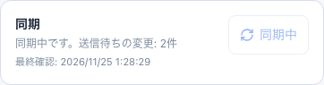
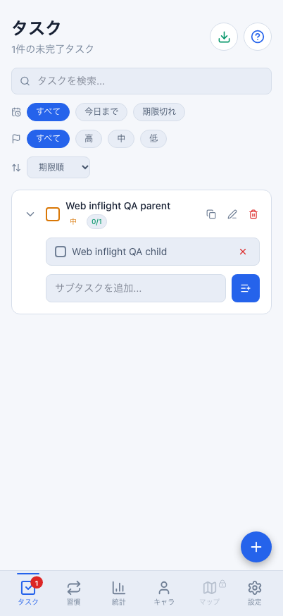

# Webの同期中に認証が更新されたとき、期限切れの要求を送り直せることを確認する（2026-11-25）

計画④ [#699](https://github.com/YuTakane256/Life-Quest/issues/699) のR3／T08。main `0a05ee98afcd1aa444bd3fb8b8d1e7fcbd9d0ffd` を、専用Chromium（402×874）とローカルSupabaseで検証した。ローカルAuthのJWT有効期間は180秒。[起動時の認証更新](web-auth-refresh-response-loss-20261125.md)に続き、今回はログイン済みの画面を開いたまま、送信中の要求と認証更新が重なる条件を確認した。

1. Aでログインし、通常フォームから未完了の親タスクとサブタスクを各1件作成した。最初の親の送信だけを、ブラウザーが送信を開始したあとローカル中継で保留した。この時点で要求のアクセストークン（JWT）は有効だった。キューは親が送信中、子が親に依存した保留の各1件だった。
2. 親の要求を中継に保持したまま、同じ画面のSupabase SDKがAの認証を自動更新した。親子の操作と受信カーソルはそのままで、送信再開前にDBで比較した両アカウントの親子タスク、操作の記録、XPと報酬台帳は開始時と一致した。元のJWTの有効期限を過ぎてから、保留していた要求を、元のAuthorizationヘッダーのJWTを保持したまま実Supabaseへ転送した。Supabaseから返った期限切れのHTTP 401をブラウザーが受け取った。
3. アプリは更新後のJWTで、元と同じ操作キー・行IDの親を送り直した。続いて同じ依存関係の子を送り、親・子ともにHTTP 200、両方の書き込み後の受信も成功した。再ログイン・再読み込み・手動同期は不要だった。送信JWTが更新応答に含まれていたものと一致することは中継のメモリ内で照合した。
4. AのDBに未完了の親子が各1件、比較アカウントBは各0件だった。両者のXPと報酬台帳は開始時と一致した。保存キューは空になり、受信カーソルは子の版まで進んだ。設定に「同期済み」と表示され、タスク画面にも親子が表示された。

| 親を送信中・子を保留している設定の同期欄 | 同じページ内で復帰した親子タスク |
| --- | --- |
|  |  |

[認証情報とテスト用の識別子を除いた照合結果](evidence/web-inflight-auth-rollover-20261125.json)を添付する。認証・同期送信・再送とローカルSupabaseの関連テスト8ファイル165件も成功した。

今回確認したのは、ブラウザーから出た親作成要求を中継がゲートウェイへの転送前に保留し、認証更新のあとに古いJWTの要求が拒否される条件である。書き込み成功後の応答喪失、送信中のアカウント切り替え、Native・他ブラウザー・stagingでの同じ条件は引き続き確認する。
